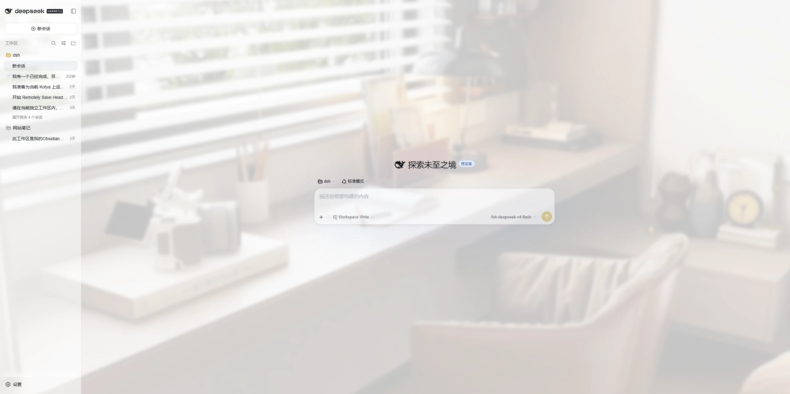
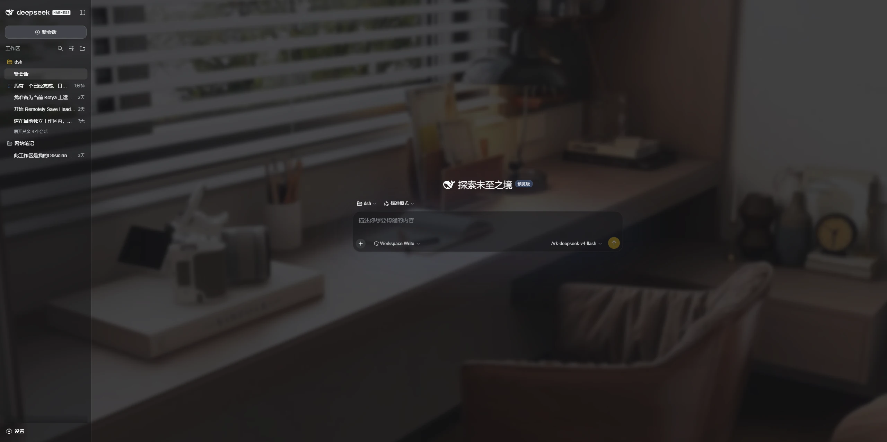
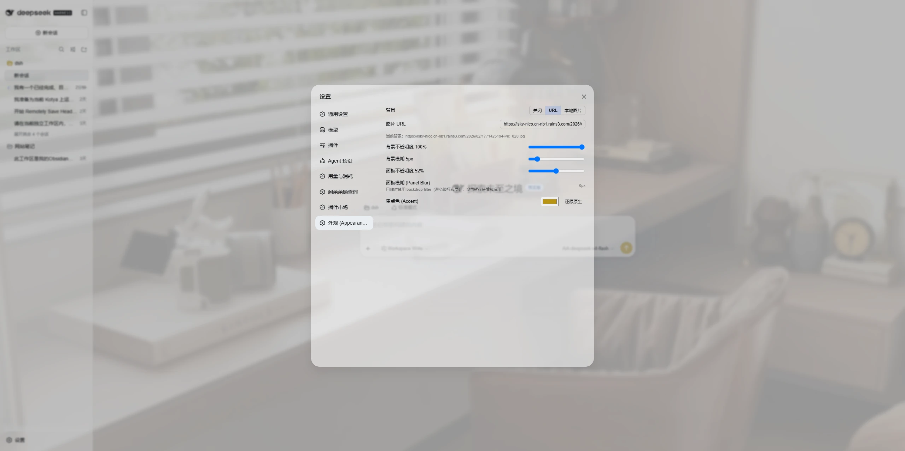

# dsh-ui-liteglass

**LiteGlass** — English | [简体中文](README.zh-CN.md)

A lightweight appearance skin for DeepSeek Harness.

**Wallpaper. Glass. Accent. That's it.**

## Screenshots

Real captures of the running plugin — light / dark main interface and the
Appearance settings — under [`docs/screenshots/`](docs/screenshots/), wired into
[`screenshots.json`](screenshots.json) for storefront display.







## Features

1. **Custom Wallpaper**
   - Remote image URL, or upload a local image
   - Adjustable background opacity and background blur

2. **Glass-like Panels**
   - Adjustable panel transparency for a lightweight glass-like look

3. **Accent Color**
   - Customize the accent color used across supported DSH interface states
   - Adapts automatically to DSH's native Light / Dark appearance

## What makes it different

- **Server-side persistence, multi-device.** Settings and uploaded wallpaper are
  stored on the DSH host (not in the browser), so every device that reaches the
  host shares the same look.
- **Does not take over the native color mode.** Light / Dark / System stays fully
  owned by DSH native settings; the plugin only enhances appearance on top.
- **No second theme system.** Built on the official `theme.overrideTokens` seam
  and the DSH token system — no bundled CSS framework, no competing theme model.
- **Small, focused, predictable.** Wallpaper + glass + accent, nothing else.

## Identity

| Field | Value |
|---|---|
| package | `dsh-ui-liteglass` |
| display name | **LiteGlass** |
| plugin id (client module / settings row seat / theme source) | `dsh-ui-liteglass` |
| rowId / wiring.id (loader entry / skin-market) | `ui-liteglass` |

`rowId` matches the loader entry id in `cordis.patch.yml`, which is what skin
markets use for mutual-exclusion wiring. See `docs/IDENTITY.md` for the canonical
record.

## Compatibility

- **Supported:** the DeepSeek Harness `0.2.1-rc` line. The plugin uses only stable
  official seams (`webServer.register`, `ctx.effect`, the `connection`
  authentication service, `settings.describe()`, `theme.overrideTokens`,
  `dsh.client` inject and the `settings.general.item` slot).
- **Tested with:** DeepSeek Harness `0.2.1-rc.2` (client theme bundle and settings
  shell from the same build).
- **Not supported:** the `0.1.0-rc` line. `0.2.0` requires the `connection`
  service and the `settings.describe()` API, neither of which exists there.

DeepSeek Harness is still evolving quickly, so a future release may change plugin
interfaces; the supported range above is a declaration, not a promise of
forward-compatibility.

## Installation

From npm (once published):

```sh
dsh plugin --profile web add dsh-ui-liteglass
```

Or directly from the GitHub repository (works today):

```sh
dsh plugin --profile web add git+https://github.com/mumuer1024/dsh-ui-liteglass.git
dsh --profile web
```

To pin a specific release, add the tag:

```sh
dsh plugin --profile web add 'git+https://github.com/mumuer1024/dsh-ui-liteglass.git#v0.2.0'
```

`dsh plugin add` initializes the profile on first use and wires the bundle
automatically. After that, start the Web UI and open **Settings → General**; the
LiteGlass block sits directly under the native **Appearance** row.

## Configuration

Open **Settings → General** (the plugin contributes a block to that page, right
below the native Appearance row):

- **Background**: Off / URL / local upload; background opacity; background blur.
- **Panel transparency**: how translucent the main surfaces are.
- **Accent color**: pick a color, or reset to the native value. Accent colors the
  emphasis states (selection, links, info fills, sidebar markers). **Colorful
  primary buttons** is a separate, default-off switch that additionally paints
  the primary button — on by default it would override the monochrome primary
  fill that DSH 0.2.x uses.

Changes are saved to the server and shared across devices that reach the DSH host.

All plugin routes require a signed-in DSH session and reject cross-origin writes,
so an unauthenticated visitor who can reach the host cannot read or rewrite the
plugin config.

## Uninstallation

```sh
dsh plugin --profile web remove dsh-ui-liteglass
```

Removing the plugin restores the original appearance. Note that uploaded
wallpaper files and the plugin config under `$DSH_HOME/ui-liteglass/` are not
removed by the uninstall command — delete that directory manually if you want
them gone.

## Known Limitations

- **Panel blur (`backdrop-filter`) is currently not enabled.** Applying a
  backdrop blur to the main panel containers breaks Settings / overlay
  positioning in the current build, so that effect is disabled. Background blur
  and panel transparency are functional and are not affected.
- The color mode (Light / Dark / System) is always controlled by DSH native
  settings — this plugin does not provide a color-mode switch.
- The settings block is registered into the `settings.general.item` slot. A
  composition that ships without the General settings page has no seat for it,
  so the block simply does not appear there.

## Development / Testing

Automated Node test suites cover the host routes, the client state model, and the
no-color-mode guarantee:

```sh
npm test
# host-smoke       routes: auth, sanitization, upload limits, pruning, dispose
# client-contract  settings seat, token layer, accent pairing, unload restore
# lifecycle        config store
# no-appearance    never touches the native color mode
```

`npm publish` runs the same suites via `prepublishOnly`. See
`docs/ARCHITECTURE.md` for design details.

## License

[MIT](LICENSE)
