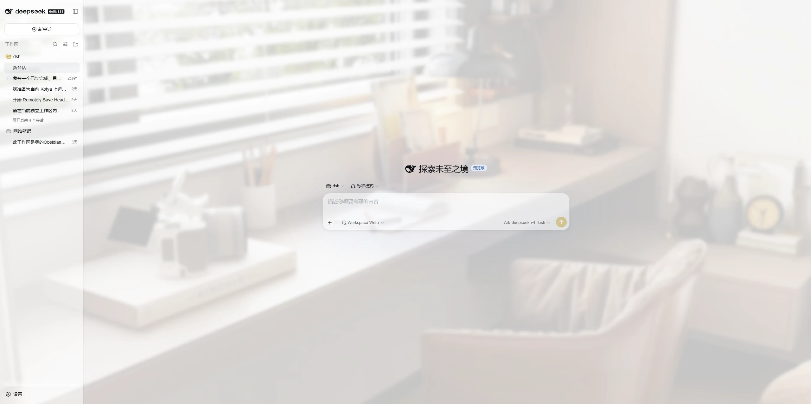
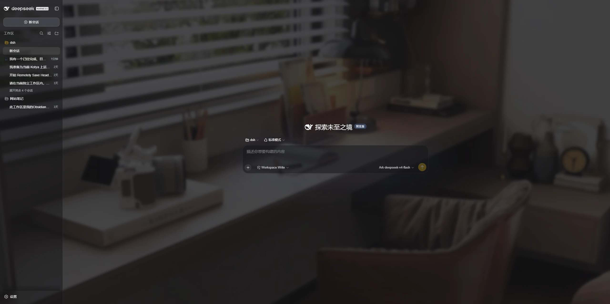
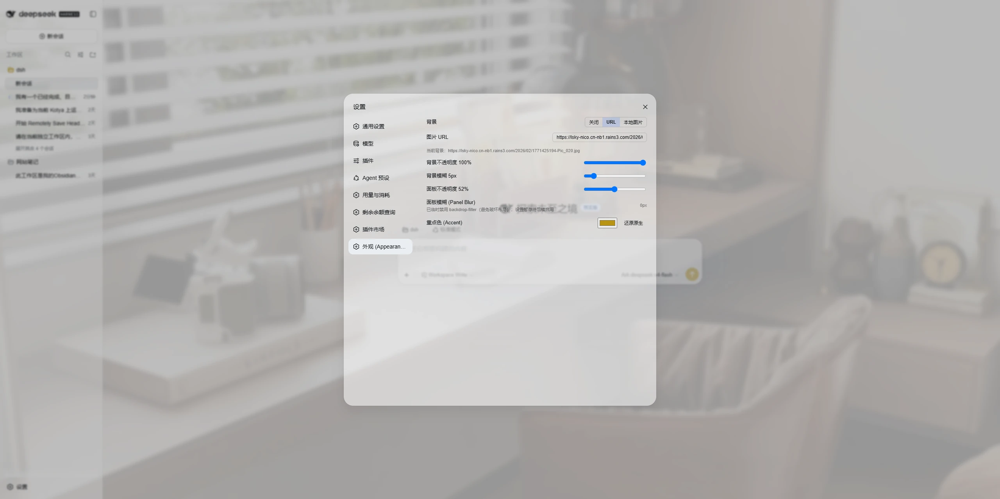

# dsh-ui-liteglass

**LiteGlass** — [English](README.md) | 简体中文

一个轻量级的 DeepSeek Harness 外观皮肤插件。

**Wallpaper. Glass. Accent. 仅此而已。**

## 截图

运行中的真实截图——浅色 / 深色主界面与外观设置页——放在
[`docs/screenshots/`](docs/screenshots/)，并通过
[`screenshots.json`](screenshots.json) 接入市场展示。







## 功能

1. **自定义壁纸**
   - 支持远程图片 URL，或本地上传图片
   - 可调节背景不透明度与背景模糊

2. **玻璃质感面板**
   - 可调节面板透明度，营造轻量的玻璃质感

3. **重点色 (Accent)**
   - 自定义 DSH 界面中受支持状态的重点色
   - 自动适配 DSH 原生浅色 / 深色外观

## 差异化

- **服务端持久化、多设备一致**：设置与上传壁纸保存在 DSH 主机端（而非浏览器），
  任何能访问主机的设备都看到同一套外观。
- **不接管原生颜色模式**：Light / Dark / System 完全由 DSH 原生设置管理，
  插件只在其之上增强外观。
- **不建立第二套主题系统**：基于官方 `theme.overrideTokens` 缝与 DSH token 体系，
  无自带 CSS 框架、无竞争主题模型。
- **小巧、专注、可预期**：壁纸 + 玻璃 + 重点色，仅此而已。

## 身份标识 (Identity)

| 字段 | 值 |
|---|---|
| package | `dsh-ui-liteglass` |
| display name | **LiteGlass** |
| plugin id（client module / 设置行座位 / theme source） | `dsh-ui-liteglass` |
| rowId / wiring.id（loader entry / skin-market） | `ui-liteglass` |

`rowId` 与 `cordis.patch.yml` 中的 loader entry id 一致，皮肤市场用它做互斥接线。
权威记录见 `docs/IDENTITY.md`。

## 兼容性

- **Supported（声明支持）**：DeepSeek Harness `0.2.1-rc` 线。插件只使用稳定的官方缝
  （`webServer.register`、`ctx.effect`、`connection` 鉴权服务、`settings.describe()`、
  `theme.overrideTokens`、`dsh.client` inject、`settings.general.item` 插槽）。
- **Tested with（已验证）**：DeepSeek Harness `0.2.1-rc.2`（client theme 与 settings
  shell 同属该构建）。
- **不支持**：`0.1.0-rc` 线。`0.2.0` 依赖 `connection` 服务与 `settings.describe()`，
  这两者在旧线中都不存在。

DeepSeek Harness 仍在快速迭代，未来版本可能改变插件接口；以上支持范围是声明，
而非向前兼容承诺。

## 安装

从 npm（发布后）：

```sh
dsh plugin --profile web add dsh-ui-liteglass
```

或直接从 GitHub 仓库安装（现在即可用）：

```sh
dsh plugin --profile web add git+https://github.com/mumuer1024/dsh-ui-liteglass.git
dsh --profile web
```

如需固定到某个具体版本，可在 URL 后附加 tag：

```sh
dsh plugin --profile web add 'git+https://github.com/mumuer1024/dsh-ui-liteglass.git#v0.2.0'
```

`dsh plugin add` 会在首次使用时初始化 profile，并自动接入 bundle。之后启动 Web UI，
打开 **设置 → 通用 (General)**，LiteGlass 区块就在原生 **外观 (Appearance)** 行下方。

## 配置

打开 **设置 → 通用 (General)**（插件向该页贡献一个区块，位于原生外观行下方）：

- **背景**：关闭 / URL / 本地上传。上传支持 PNG / JPEG / WebP / GIF，单张上限
  **8 MiB**——面板里直接写明上限，超过的文件在浏览器端就被拦下，不会发出请求；失败会
  在面板里说明原因（超限、格式不符、会话失效、网络错误）。
- **背景不透明度**：10% 一档。**背景模糊**：5px 一档，上限 30px。
- **面板不透明度**：10% 一档。
- **重点色**：九个预设 + 「原生」重置。DSH 自身没有重点色设置（`ui-theme` 只存颜色
  模式与字号），所以这套调色板属于插件。**彩色主按钮**是另一个默认关闭的开关，开启后
  才额外染主按钮——DSH 0.2.x 的主按钮是单色填充，默认接管会破坏这一设计。

分段控件是刻意替换掉连续滑块的：每次点击只产生一次变更，拖动不再导致“每像素一次保存
+ 一次 token 层重建”。

配置保存在 DSH 主机端，因此通过不同设备访问时也会使用同一套外观配置。

插件所有路由都要求已登录的 DSH 会话，并拒绝跨站写请求；能访问主机的未认证访客既读
不到也改不了插件配置。

## 卸载

```sh
dsh plugin --profile web remove dsh-ui-liteglass
```

移除插件后外观会恢复原样。注意：上传的壁纸文件与插件配置位于
`$DSH_HOME/ui-liteglass/`，卸载命令不会删除它们——如需清理，请手动删除该目录。

## 已知限制

- **面板模糊（`backdrop-filter`）目前未启用。** 在当前构建中，对主面板容器施加
  背景模糊会破坏设置页 / 浮层定位，因此该效果被禁用。背景模糊与面板透明是可用的，
  不受影响。
- 颜色模式（Light / Dark / System）始终由 DSH 原生设置控制——本插件不提供颜色模式切换。
- 设置区块注册进 `settings.general.item` 插槽；若某个组合没有通用设置页，就没有承载位，
  该区块不会出现。

## 开发 / 测试

内置 Node 测试覆盖 host 路由、客户端状态模型，以及“不控制颜色模式”的保证：

```sh
npm test
# host-smoke       路由：鉴权、归一化、上传限制、回收、dispose
# client-contract  设置位置、token 层、重点色配对、卸载还原
# lifecycle        配置存储
# no-appearance    绝不触碰原生颜色模式
```

`npm publish` 会经 `prepublishOnly` 先跑同一套测试。设计细节见 `docs/ARCHITECTURE.md`。

## 许可证

[MIT](LICENSE)
